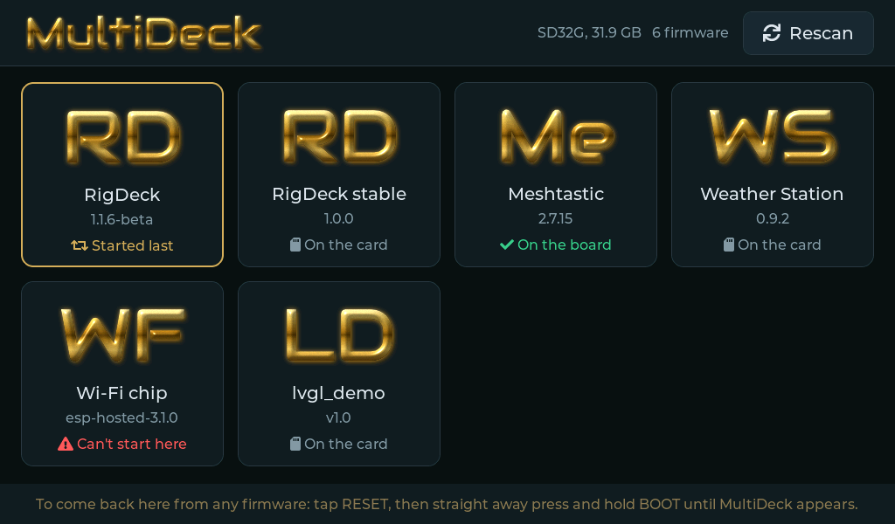

# MultiDeck

**A firmware launcher for the RigDeck board: keep several firmware on a microSD card and pick one on the touch screen.**



MultiDeck runs on the **Waveshare ESP32-P4-WIFI6-Touch-LCD-7B**. It sits in the board's
factory partition and:

- lists every `.bin` in the `firmware` folder of the microSD card as a tile (gold monogram, name, version);
- reads each file before touching flash: ESP32-P4 or another chip, chip revision, size, damaged or cut short;
- takes both kinds of file: an application image (`build/<project>.bin`) or a full-flash release image
  (`rigdeck-1.0.0.bin`, merged for address 0x0), from which it copies just the app;
- copies the one you pick into an app slot with a progress bar, checks it, and starts it;
- keeps the **last two firmware started** on the board: starting one of those again takes no copying, and
  works without the card;
- comes back when you **tap RESET, then press and hold BOOT** (no PC needed), or when a firmware calls
  `multideck_return()`.

## Status

**Version 1.0.0.** Not yet run on hardware. Checked here:

- `sh test/build.sh`: the image reader against synthetic images (every padding case, cut-short, damaged, merged)
  and against RigDeck's real release files. For each image the SHA-256 is recomputed over the bytes MultiDeck
  would copy and matches the digest esptool stored, so offsets and lengths are right:
  `sh test/build.sh ../RigDeck/docs/stable/rigdeck.bin ../RigDeck/docs/firmware/rigdeck.bin`
- `LVGL=... sh test/ui_sim.sh`: the real touch interface on LVGL 9.5 on a PC, tapped through start-up, details,
  copying, a failed copy, wrong chip, no card and empty card (screenshots in `test/out/ui/`).
- Board code checked against ESP-IDF 6.1 headers. Built with `idf.py build`: not yet.

## Flash layout

The same as RigDeck's (`partitions.csv`), so RigDeck runs from MultiDeck unchanged and keeps its settings,
log and Wi-Fi chip image:

| Partition | Offset | Size | Use |
|---|---|---|---|
| nvs | 0x9000 | 24 kB | settings (shared by all firmware; MultiDeck never erases it) |
| factory | 0x10000 | 3 MB | **MultiDeck** |
| storage | 0x310000 | 2 MB | RigDeck's SPIFFS |
| c6fw | 0x600000 | 1.75 MB | RigDeck's Wi-Fi chip image |
| otadata | 0x7C0000 | 8 kB | which slot starts; blank = MultiDeck |
| ota_0 / ota_1 | 0x800000 / 0xC00000 | 4 MB each | the last two firmware started |

A firmware is matched to a slot by its SHA-256 (the digest esptool appends to every image), so if a firmware
replaces itself in a slot (RigDeck's own Wi-Fi update does), MultiDeck sees that and copies from the card
again when needed.

## Getting back to MultiDeck

`bootloader_components/multideck_boot_hook` adds a check to the bootloader: for 500 ms after a reset it watches
the BOOT button (GPIO 35). Held for 30 ms in that window, it blanks `otadata`, and the bootloader starts the
factory app, MultiDeck. Nothing else is erased.

BOOT is also the chip's download-mode strapping pin, so **holding BOOT while releasing RESET enters USB
download mode** (blank screen): tap RESET again. The window and pin are in `idf.py menuconfig` >
*MultiDeck return button (bootloader)*.

Note: this needs MultiDeck's bootloader. Flashing a full-flash image of another firmware over USB replaces
the bootloader and partition table; put MultiDeck back with its flasher page afterwards.

### A "Back to MultiDeck" button in your own firmware

Copy `components/multideck_return` into your project's `components/`, then:

```c
#include "multideck_return.h"
if (multideck_present()) { /* show the button */ }
multideck_return();   // on tap: selects the factory partition (MultiDeck) and restarts
```

For RigDeck that is one button in Settings > Device next to "Restart".

## The microSD card

FAT32, folder `firmware` (change it in menuconfig > MultiDeck). Files starting with `.` or `_` are skipped
(macOS writes `._name.bin` files). Optional `Name.txt` next to `Name.bin`: first line = title on the tile,
next lines = description.

## Building

ESP-IDF 6.1, as RigDeck:

```
idf.py build
idf.py -p COM5 flash            # first time; or use the flasher page (docs/) after .\release.ps1
```

Or double-click `tools\update_flash.bat` (pull from GitHub, build, flash), as for RigDeck. See `tools/README.md`.

`sdkconfig.defaults` sets the target (esp32p4), 32 MB flash, PSRAM, LVGL and the partition table.
App rollback is **off** in MultiDeck's bootloader: with it on, firmware that never confirms itself (most
firmware) would be thrown out after its second reset.

`.\release.ps1` builds `build\multideck-<version>.bin` (address 0x0) and the flasher page files in `docs\`.
The flasher page writes MultiDeck plus a blank `otadata`, and ends before RigDeck's data partitions.

## Files

| | |
|---|---|
| `main/fwimage.c` | reads a .bin: app or merged image, app descriptor, segments, SHA-256 (plain C, tested on a PC) |
| `main/launcher.cpp` | card scan, slot matching, copy / check / start |
| `main/ui.cpp` | touch interface; `goldText` is RigDeck's gold renderer |
| `main/sdcard.c`, `display.c` | card and display set-up as in RigDeck |
| `main/logo_font.c` | Audiowide subset (as RigDeck) |
| `bootloader_components/multideck_boot_hook` | BOOT-after-reset check |
| `components/multideck_return` | for other firmware: return to MultiDeck |
| `test/` | image reader test, PC preview of the interface |
| `tools/` | Windows helpers as in RigDeck: update & flash, release, serial log capture |

## Licence

MIT (LICENSE). Audiowide font by Astigmatic, SIL Open Font License 1.1 (`logo/OFL.txt`). See THIRD_PARTY.md.
